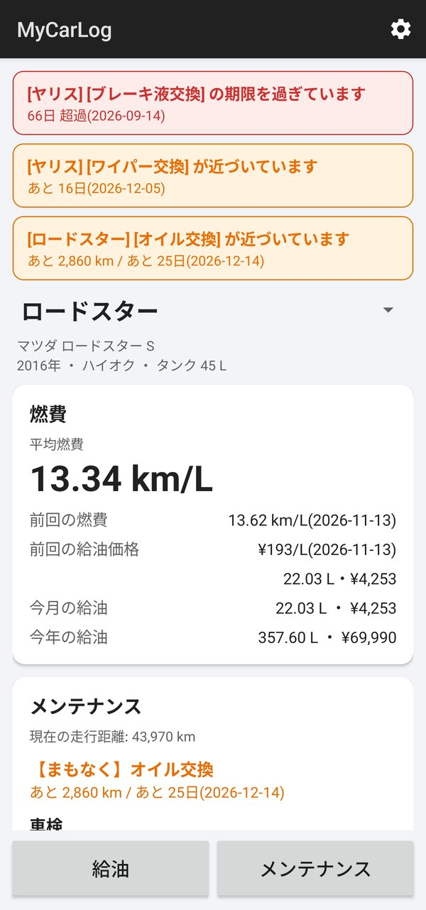
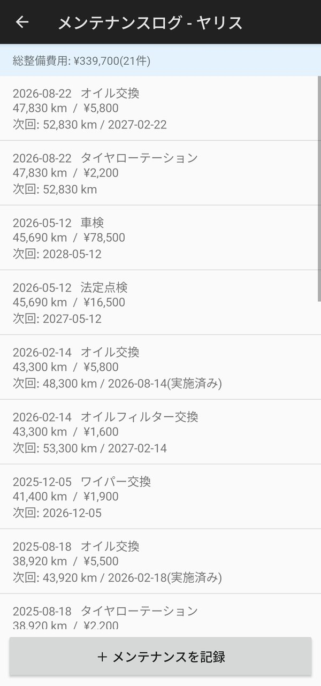
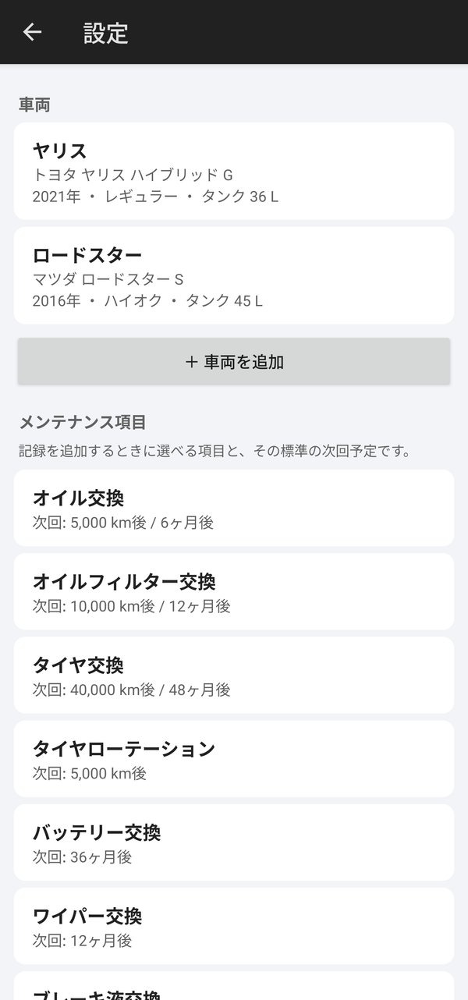

# MyCarLog

給油・燃費・メンテナンスを記録する、Android 向けのシンプルな車両管理アプリです。

## スクリーンショット
画像は架空のデータです。

<p>



</p>
<p>


</p>

## 機能
- 給油記録と燃費計算(満タン〜満タン方式)
- メンテナンス記録と次回予定(走行距離 / 期間)、期限が近づくと通知
- 複数車両の管理(メーカー・車種・グレード・年式・油種・タンク容量・ナンバー・VIN・所有中かどうか)
- メンテナンス項目と標準の次回予定を設定で編集
- JSON でのデータのエクスポート / インポート
- GitHub のリリースからのアップデート通知とインストール(設定の「更新を確認」)

データは端末内にのみ保存され、外部には送信されません。

## ビルド
Android SDK(compileSdk 34)と JDK 17、Gradle 8.7 が必要です。`local.properties` に `sdk.dir` を設定してください。

```
gradle :app:assembleDebug
```

リリース署名をする場合は、キーストアを用意し、次のプロパティを指定します(リポジトリには含めないでください)。

```
gradle :app:assembleRelease -PreleaseStoreFile=... -PreleaseStorePassword=... -PreleaseKeyAlias=... -PreleaseKeyPassword=...
```

動作環境: Android 8.0 (API 26) 以上。
