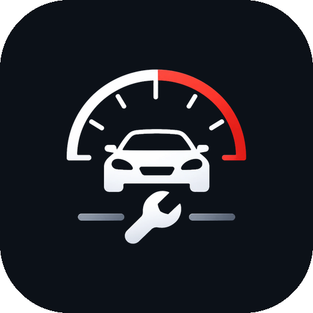
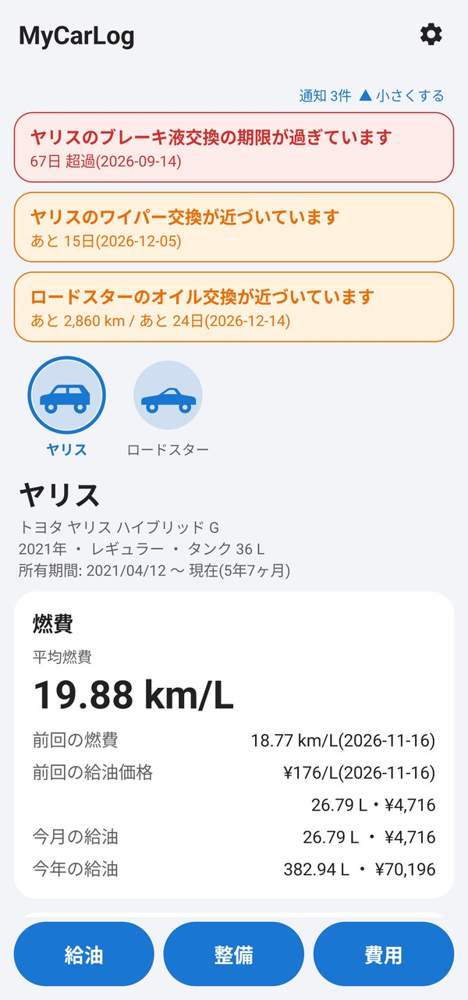
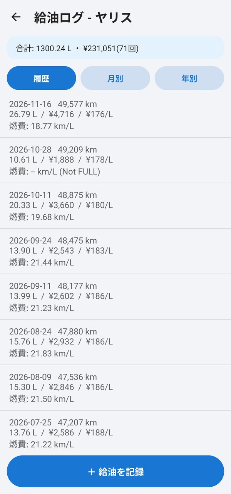
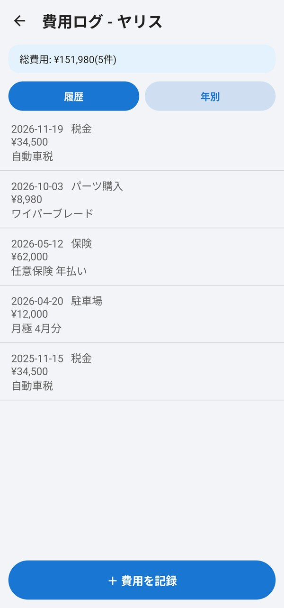

#  MyCarLog

給油・燃費・整備を記録する、Android 向けのシンプルな車両管理アプリです。

## スクリーンショット

## 機能
- 給油記録と燃費計算(満タン〜満タン方式)
- 整備記録と次回予定(走行距離 / 期間)、期限が近づくと通知
- 複数車両の管理(メーカー・車種・グレード・年式・油種・タンク容量・ナンバー・VIN・所有中かどうか)
- 税金・保険・パーツ購入などの費用を記録(履歴 / 年別の集計)
- 整備項目と標準の次回予定を、整備ログ右上の設定ボタンで編集
- 車両ごとに写真(正方形に切り取り可)または車種アイコン(セダン / ハッチバック / スポーツカー / ワゴン / SUV / ミニバン / トラック / 軽自動車)を設定し、ホームでアイコンから車両を切り替え。設定で長押しドラッグして並び替え
- 購入日・手放した日から所有期間を表示。過去の車両の記録もあとから確認可能
- ホームの通知を1行にまとめて小さく表示
- 配色テーマの切り替え(標準 / ダーク / ブルー / グリーン / スポーツ)
- JSON でのデータのエクスポート / インポート
- GitHub のリリースからのアップデート通知とインストール(設定の「更新を確認」)

データは端末内にのみ保存され、外部には送信されません。

動作環境: Android 8.0 (API 26) 以上。
